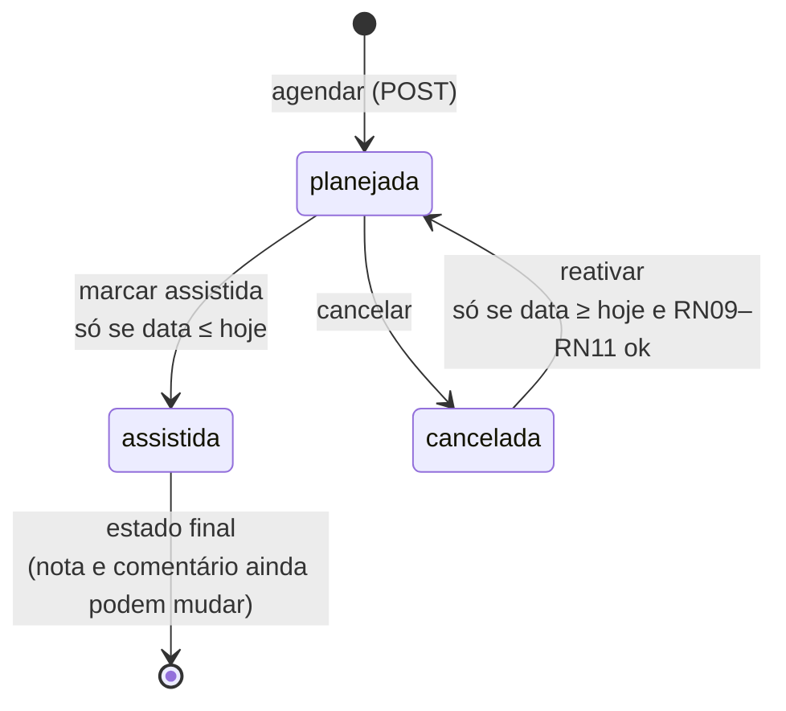
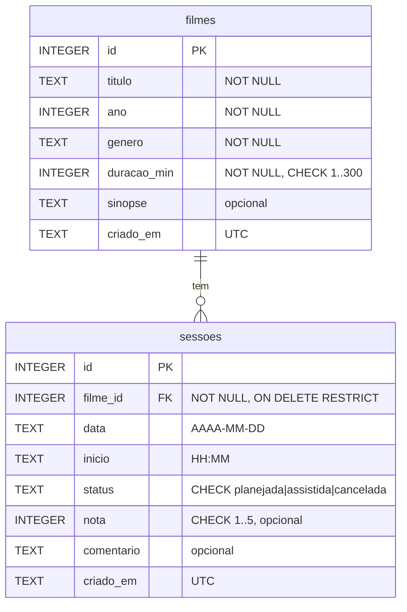

# Especificação de Requisitos — Agenda de Filmes

| | |
|---|---|
| **Versão do documento** | 1.0 (sistema 1.0.0) |
| **Objetivo** | Servir de **base (oráculo) para os testes de QA**: cada regra tem um número, valores-limite exatos e a mensagem que o sistema deve exibir |
| **Documentos relacionados** | [Roteiro de QA](ROTEIRO_QA.md) · [README](../README.md) |

> **Como usar este documento:** cada teste que você escrever deve citar o requisito que ele verifica (ex.: "CT-API-12 verifica RN09"). Se o sistema se comportar diferente do que está escrito aqui, é **bug**. Se o documento for vago ou contraditório, também é achado de QA: registre como *dúvida de requisito*.

---

## 1. Visão geral

A **Agenda de Filmes** é um organizador diário: a pessoa mantém um **catálogo** de filmes e monta, para cada dia, uma **agenda de sessões** ("vou ver *Interestelar* às 19:00"). Depois de assistir, marca a sessão como assistida e dá uma nota.

| Parte | Tecnologia |
|-------|-----------|
| Front-end | HTML, CSS e JavaScript puro (`public/`) |
| Backend / API REST | Rust + Axum (`src/main.rs`) |
| Banco | SQLite (`data/agenda.db`) |
| Entrega | Docker (multi-stage) e GitHub Actions |

**Ator único:** o usuário (não há login; todos que acessam o mesmo servidor veem a mesma agenda).

### Glossário
| Termo | Significado |
|-------|-------------|
| **Filme** | Item do catálogo: título, ano, gênero, duração e sinopse |
| **Sessão** | Um filme agendado para uma data e um horário de início |
| **Fim da sessão** | Início + duração do filme (calculado, não é enviado) |
| **Sessão ativa** | Sessão com status `planejada` ou `assistida` (não cancelada) |
| **Minutos agendados** | Soma das durações das sessões ativas do dia |
| **Hoje** | Data atual do servidor (fuso `TZ`; no Docker, horário de Brasília). Pode ser fixada para testes (seção 9) |

---

## 2. Requisitos funcionais

Formato dos critérios de aceite: **Dado** (situação) / **Quando** (ação) / **Então** (resultado).

### Agenda

**RF01 — Ver a agenda de um dia**
- CA01: Dado que abro a aplicação, então vejo a agenda de **hoje**, com a data por extenso (ex.: "Segunda-feira, 9 de novembro de 2026") e o selo **Hoje**.
- CA02: Quando clico em ◀ ou ▶, então a agenda mostra o dia anterior/seguinte. O selo muda para **Passado** ou **Futuro**.
- CA03: Quando escolho uma data no campo de data ou clico em **Hoje**, então a agenda mostra esse dia.
- CA04: Quando abro a URL com `#AAAA-MM-DD` (ex.: `http://localhost:3001/#2026-12-25`), então a agenda abre direto nesse dia. Ao navegar, a URL é atualizada.
- CA05: As sessões aparecem **ordenadas pelo horário de início**, cada uma com horário "início – fim", título, gênero, duração e status.
- CA06: Dia sem sessões mostra "Nenhuma sessão neste dia." e o contador 0.

**RF02 — Ver o resumo do dia**
- CA01: O resumo mostra "*minutos agendados* / 480 min", os minutos livres e uma barra de progresso proporcional.
- CA02: Mostra a quantidade de sessões planejadas, assistidas e canceladas.
- CA03: Mostra a nota média das sessões do dia com 1 casa decimal (ex.: "4,5"), ou "—" se não houver notas.
- CA04: Com 480 minutos agendados, a barra fica vermelha e os minutos livres são 0.
- CA05: O resumo é atualizado após qualquer ação na agenda, sem recarregar a página.

**RF03 — Agendar sessão**
- CA01: Dado um filme e um horário válidos, quando clico em **Agendar**, então a sessão aparece na lista e a mensagem `"<Título>" agendado das HH:MM às HH:MM.` é exibida.
- CA02: A sessão é criada na **data que está sendo exibida** na agenda.
- CA03: Se a API recusar, a mensagem de erro dela é exibida; se o erro for de um campo, ele também aparece embaixo do campo, que fica destacado.
- CA04: O formulário é limpo após o sucesso.

**RF04 — Marcar como assistida**
- CA01: Uma sessão planejada de hoje ou de um dia passado tem o botão **✓ Assistida**. Ao clicar, o status muda para "Assistida" e a mensagem `"<Título>" marcado como assistido.` aparece.
- CA02: Em sessão de dia futuro, a ação é recusada (RN13).

**RF05 — Avaliar sessão assistida**
- CA01: Sessões assistidas mostram um seletor de nota (Sem nota, 1★ a 5★) e um campo de comentário com o botão **Salvar avaliação**.
- CA02: Ao salvar, as estrelas (★★★★☆) e o comentário entre aspas aparecem no card, e a mensagem "Avaliação salva." é exibida.

**RF06 — Cancelar sessão**
- CA01: Sessão planejada tem o botão **Cancelar**. A sessão continua na lista, riscada, com status "Cancelada", e para de ocupar a agenda (RN16).

**RF07 — Reativar sessão cancelada**
- CA01: Sessão cancelada tem o botão **Reativar**, que a devolve para "Planejada", desde que as regras RN09 a RN12 continuem sendo cumpridas.

**RF08 — Excluir sessão**
- CA01: Toda sessão tem o botão **Excluir**, que a remove definitivamente (sem confirmação).

### Catálogo

**RF09 — Listar filmes**
- CA01: A aba **Catálogo** mostra os filmes em tabela (título, ano, gênero, duração, número de sessões), **em ordem alfabética de título**, sem diferenciar maiúsculas.
- CA02: Mostra o total ("12 filmes"; no singular, "1 filme").

**RF10 — Buscar e filtrar**
- CA01: A busca encontra filmes cujo título **contém** o texto digitado, sem diferenciar maiúsculas (ex.: "ba" encontra "Bacurau").
- CA02: O filtro de gênero mostra só os filmes do gênero escolhido. Busca e filtro funcionam juntos.
- CA03: Sem resultados, aparece "Nenhum filme encontrado."

**RF11 — Cadastrar filme**
- CA01: Com dados válidos (RN01 a RN06), o filme entra no catálogo, aparece no seletor da agenda e a mensagem `"<Título>" adicionado ao catálogo.` é exibida.
- CA02: Com dados inválidos, a mensagem de erro aparece no topo e embaixo do campo correspondente.

**RF12 — Editar filme**
- CA01: **Editar** carrega o filme no formulário, cujo título muda para "Editar filme: <Título>", e mostra **Cancelar edição**.
- CA02: Ao salvar, a mensagem `"<Título>" atualizado.` aparece e o formulário volta para "Novo filme".
- CA03: As mesmas regras do cadastro valem, além da RN07.

**RF13 — Excluir filme**
- CA01: **Excluir** remove o filme do catálogo, com a mensagem `"<Título>" removido do catálogo.`, desde que ele não tenha sessões (RN15).

### Geral

**RF14 — Persistência**
- CA01: Filmes e sessões continuam salvos após recarregar a página, fechar o navegador ou reiniciar o servidor.
- CA02: Na primeira execução (banco vazio), o catálogo começa com os 12 filmes da seção 9.3.

---

## 3. Regras de negócio

### Filmes
| ID | Regra | Válido | Inválido |
|----|-------|--------|----------|
| RN01 | **Título** obrigatório, de 1 a **100** caracteres, contados depois de remover os espaços das pontas | 1 e 100 caracteres | vazio, só espaços, 101 caracteres |
| RN02 | **Ano** obrigatório, inteiro de **1888** até **ano atual + 5** (em 2026: 2031) | 1888, 2031 | 1887, 2032, ausente |
| RN03 | **Gênero** obrigatório, um destes 11: Ação, Animação, Aventura, Comédia, Documentário, Drama, Fantasia, Ficção científica, Romance, Suspense, Terror. Aceita maiúsculas/minúsculas e espaços nas pontas; grava sempre a grafia oficial | `"  drama "` → grava `"Drama"` | `"Faroeste"`, vazio |
| RN04 | **Duração** obrigatória, inteiro de **1** a **300** minutos | 1, 300 | 0, 301, ausente |
| RN05 | **Sinopse** opcional, até **500** caracteres; em branco vira `null` | 500 caracteres | 501 caracteres |
| RN06 | Não pode haver dois filmes com o **mesmo título e o mesmo ano**, sem diferenciar maiúsculas (vale também na edição) | "Duna" 1984 e "Duna" 2021 | "Interestelar" 2014 e "INTERESTELAR" 2014 |
| RN07 | A **duração** de um filme não pode ser alterada se ele tiver sessões **planejadas** (título, ano, gênero e sinopse podem) | filme sem sessões planejadas | filme com sessão planejada |
| RN15 | Filme com **qualquer** sessão (de qualquer status) **não pode ser excluído** | filme sem sessões | filme com sessão cancelada |

### Sessões
| ID | Regra | Válido | Inválido |
|----|-------|--------|----------|
| RN08 | A sessão deve **terminar no mesmo dia**: início + duração ≤ 24:00 | filme de 120 min às 22:00 (termina 24:00) | filme de 120 min às 22:01 |
| RN09 | **Limite diário de 480 minutos** de sessões ativas | total exatamente 480 | total 481 |
| RN10 | O **mesmo filme** não pode ter duas sessões ativas no mesmo dia | mesmo filme em dias diferentes; ou uma das sessões cancelada | duas sessões ativas do mesmo filme no dia |
| RN11 | Sessões ativas **não podem se sobrepor**. Encostar é permitido: uma pode começar no minuto exato em que a outra termina | 19:00–21:49 e 21:49–23:10 | 19:00–21:49 e 21:48–23:09 |
| RN12 | Não é possível **agendar em data passada** (data < hoje). Hoje é permitido; **só a data é comparada**, não o horário | hoje, amanhã | ontem |
| RN13 | **Transições de status** — ver diagrama abaixo | | |
| RN14 | **Nota**: inteiro de **1 a 5**, só em sessão **assistida**; `null` remove a nota. **Comentário**: opcional, até **280** caracteres, em qualquer status; em branco remove | nota 1 e 5; comentário de 280 | nota 0 e 6; nota em sessão planejada; comentário de 281 |
| RN16 | Sessões **canceladas** não contam para RN09, RN10 e RN11 e não somam minutos no resumo, mas continuam na lista e no contador "Canceladas" | | |
| RN17 | **Nota média** do resumo = média das notas do dia, arredondada para 1 casa decimal; sem notas = `null` | notas 4 e 5 → 4,5 | |

### Diagrama de estados da sessão (RN13)



| De \ Para | planejada | assistida | cancelada |
|-----------|-----------|-----------|-----------|
| **planejada** | sem efeito (200) | ✔ se data ≤ hoje | ✔ |
| **assistida** | ✘ 409 | sem efeito (200) | ✘ 409 |
| **cancelada** | ✔ se data ≥ hoje + RN09–RN11 | ✘ 409 (reative antes) | sem efeito (200) |

---

## 4. Requisitos não funcionais

| ID | Requisito | Como verificar |
|----|-----------|----------------|
| RNF01 | **Desempenho:** toda requisição da API responde em menos de **500 ms** (ambiente local) | Asserção de tempo no Postman |
| RNF02 | **Padrão de erro:** todo erro da API é JSON `{"erro": "...", "campo": "..."}` (`campo` só quando o erro é de um campo), inclusive JSON malformado (400), sem `Content-Type` (415), rota inexistente (404) e método não permitido (405) | Testes negativos de API |
| RNF03 | **Persistência:** dados em SQLite, preservados após reiniciar o servidor; no Docker, no volume `/app/data` | Teste de banco com reinício |
| RNF04 | **Segurança:** SQL sempre parametrizado (sem SQL injection); textos do usuário exibidos **como texto**, nunca interpretados como HTML (sem XSS) | Cadastrar título `` e `'); DROP TABLE filmes;--` |
| RNF05 | **Acessibilidade:** campos com rótulo; mensagens em região `role="status"`; campo inválido com `aria-invalid="true"` | Inspeção / Selenium |
| RNF06 | **Responsivo:** utilizável em telas a partir de 360 px de largura | Selenium com janela pequena / DevTools |
| RNF07 | **Testabilidade:** elementos com `data-testid`, rotas de teste e data fixável (seção 9) | — |
| RNF08 | **Portabilidade:** sobe com um único comando Docker | `docker run` |
| RNF09 | **Integração contínua:** `cargo test` roda em toda PR e push na `main` | GitHub Actions |

---

## 5. API REST

Base: `http://localhost:3001/api` (local) · `http://localhost:8081/api` (Docker). Corpo e respostas em JSON.

| Método | Rota | Descrição | Sucesso |
|--------|------|-----------|---------|
| GET | `/api/health` | Health check (texto `ok`) | 200 |
| GET | `/api/hoje` | `{"hoje": "AAAA-MM-DD"}` | 200 |
| GET | `/api/generos` | Lista dos 11 gêneros | 200 |
| GET | `/api/filmes?busca=&genero=` | Lista o catálogo (ordem alfabética), com filtros opcionais | 200 |
| GET | `/api/filmes/{id}` | Um filme | 200 |
| POST | `/api/filmes` | Cadastra | 201 |
| PUT | `/api/filmes/{id}` | Atualiza (envie todos os campos) | 200 |
| DELETE | `/api/filmes/{id}` | Exclui | 204 |
| GET | `/api/sessoes?data=&status=` | Sessões do dia (padrão: hoje), ordenadas pelo início | 200 |
| GET | `/api/sessoes/{id}` | Uma sessão | 200 |
| POST | `/api/sessoes` | Agenda | 201 |
| PATCH | `/api/sessoes/{id}` | Altera `status`, `nota` e/ou `comentario` | 200 |
| DELETE | `/api/sessoes/{id}` | Exclui | 204 |
| GET | `/api/resumo?data=` | Resumo do dia (padrão: hoje) | 200 |

### Exemplos

**Filme** — `POST /api/filmes`
```json
{ "titulo": "Bacurau", "ano": 2019, "genero": "suspense", "duracao_min": 131, "sinopse": "Opcional" }
```
```json
201 Created
{ "id": 13, "titulo": "Bacurau", "ano": 2019, "genero": "Suspense", "duracao_min": 131,
  "sinopse": "Opcional", "total_sessoes": 0, "criado_em": "2026-11-09 21:30:00" }
```

**Sessão** — `POST /api/sessoes`
```json
{ "filme_id": 7, "data": "2026-11-09", "inicio": "19:00" }
```
```json
201 Created
{ "id": 1, "filme_id": 7, "titulo": "Interestelar", "genero": "Ficção científica",
  "duracao_min": 169, "data": "2026-11-09", "inicio": "19:00", "fim": "21:49",
  "status": "planejada", "nota": null, "comentario": null, "criado_em": "2026-11-09 21:31:00" }
```

**Atualizar sessão** — `PATCH /api/sessoes/1` (envie só o que muda; `null` remove nota/comentário)
```json
{ "status": "assistida", "nota": 5, "comentario": "Obra-prima" }
```

**Resumo** — `GET /api/resumo?data=2026-11-09`
```json
{ "data": "2026-11-09", "limite_min": 480, "minutos_agendados": 250, "minutos_livres": 230,
  "total": 2, "planejadas": 1, "assistidas": 1, "canceladas": 0, "nota_media": 5.0 }
```

### Formatos aceitos
- **Data:** `AAAA-MM-DD`, com zeros à esquerda e dia existente (`2026-02-30` é inválido).
- **Horário:** `HH:MM`, de `00:00` a `23:59` (`9:00`, `24:00` e `12:60` são inválidos).
- **id na URL:** inteiro positivo; `abc` ou `0` → 400.
- `criado_em` é gravado em **UTC**.

---

## 6. Catálogo de mensagens de erro

Use estas mensagens **exatas** nas asserções.

| Código | Status | `campo` | Mensagem |
|--------|--------|---------|----------|
| E01 | 400 | titulo | `O título é obrigatório` |
| E02 | 400 | titulo | `O título deve ter no máximo 100 caracteres` |
| E03 | 400 | ano | `O ano é obrigatório` |
| E04 | 400 | ano | `O ano deve estar entre 1888 e 2031` *(o máximo muda com o ano atual)* |
| E05 | 400 | genero | `O gênero é obrigatório` |
| E06 | 400 | genero | `Gênero inválido. Use um destes: Ação, Animação, Aventura, Comédia, Documentário, Drama, Fantasia, Ficção científica, Romance, Suspense, Terror` |
| E07 | 400 | duracao_min | `A duração é obrigatória` |
| E08 | 400 | duracao_min | `A duração deve estar entre 1 e 300 minutos` |
| E09 | 400 | sinopse | `A sinopse deve ter no máximo 500 caracteres` |
| E10 | 409 | — | `Já existe um filme com este título e ano` |
| E11 | 409 | — | `Não é possível alterar a duração de um filme com sessões planejadas` |
| E12 | 409 | — | `Este filme tem sessões na agenda e não pode ser excluído` |
| E13 | 404 | — | `Filme não encontrado` |
| E14 | 400 | filme_id | `O filme é obrigatório` |
| E15 | 400 | filme_id | `Filme não encontrado` *(filme_id enviado no corpo não existe)* |
| E16 | 400 | data | `A data é obrigatória` |
| E17 | 400 | data | `Data inválida. Use o formato AAAA-MM-DD` |
| E18 | 400 | data | `Não é possível agendar em uma data passada` |
| E19 | 400 | inicio | `O horário de início é obrigatório` |
| E20 | 400 | inicio | `Horário inválido. Use o formato HH:MM` |
| E21 | 400 | inicio | `A sessão deve terminar no mesmo dia (até 24:00)` |
| E22 | 409 | — | `Este filme já está agendado neste dia` |
| E23 | 409 | — | `Conflito de horário com "<Título>" (HH:MM às HH:MM)` |
| E24 | 409 | — | `Limite diário de 480 minutos excedido: já há <X> min agendados e este filme tem <Y> min` |
| E25 | 400 | status | `Status inválido. Use: planejada, assistida ou cancelada` |
| E26 | 400 | nota | `A nota deve ser um número inteiro de 1 a 5` |
| E27 | 400 | comentario | `O comentário deve ter no máximo 280 caracteres` |
| E28 | 400 | — | `Informe ao menos um campo: status, nota ou comentario` |
| E29 | 409 | — | `Uma sessão assistida não pode mudar de status` |
| E30 | 409 | — | `Reative a sessão (status planejada) antes de marcá-la como assistida` |
| E31 | 409 | — | `Não é possível marcar como assistida uma sessão futura` |
| E32 | 409 | — | `Não é possível reativar uma sessão de data passada` |
| E33 | 409 | — | `A nota só pode ser dada a sessões assistidas` |
| E34 | 404 | — | `Sessão não encontrada` |
| E35 | 400 | — | `O id deve ser um número inteiro positivo` |
| E36 | 400 | — | `JSON malformado` |
| E37 | 400 | — | `Algum campo tem tipo inválido` *(ex.: `"ano": "dois mil"`)* |
| E38 | 415 | — | `Envie o corpo em JSON (Content-Type: application/json)` |
| E39 | 404 | — | `Rota não encontrada` |
| E40 | 405 | — | `Método não permitido nesta rota` |

### Ordem das validações
Quando há mais de um erro, a API devolve **só o primeiro**, nesta ordem:
- **POST/PUT filme:** corpo JSON (E36–E38) → (PUT) id (E35) → titulo → ano → genero → duracao_min → sinopse → (PUT) filme existe (E13) → duplicado (RN06) → (PUT) RN07.
- **POST sessão:** corpo JSON → filme_id ausente → data ausente → formato da data → inicio ausente → formato do início → data passada (RN12) → filme existe → fim no mesmo dia (RN08) → mesmo filme no dia (RN10) → sobreposição (RN11) → limite diário (RN09).
- **PATCH sessão:** corpo JSON → id (E35) → corpo sem nenhum campo (E28) → status → nota (faixa) → comentário → sessão existe (E34) → transição (RN13) → nota só em assistida (E33).
- **GET/DELETE com id:** id (E35) → existe (E13/E34) → (DELETE filme) RN15.

---

## 7. Mensagens de sucesso (interface)

| Ação | Mensagem |
|------|----------|
| Agendar | `"<Título>" agendado das HH:MM às HH:MM.` |
| Marcar assistida | `"<Título>" marcado como assistido.` |
| Cancelar | `Sessão de "<Título>" cancelada.` |
| Reativar | `Sessão de "<Título>" reativada.` |
| Excluir sessão | `Sessão de "<Título>" excluída.` |
| Salvar avaliação | `Avaliação salva.` |
| Cadastrar filme | `"<Título>" adicionado ao catálogo.` |
| Editar filme | `"<Título>" atualizado.` |
| Excluir filme | `"<Título>" removido do catálogo.` |

---

## 8. Modelo de dados (SQLite)


- Índice `ix_sessoes_data` em `sessoes(data)`.
- O backend liga `PRAGMA foreign_keys = ON` na conexão dele. **Atenção:** esse PRAGMA vale por conexão. Se você abrir o banco por outra ferramenta, precisa ligá-lo de novo para a chave estrangeira ser verificada.

---

## 9. Recursos para testes

### 9.1 Configuração (variáveis de ambiente)
| Variável | Padrão | Uso |
|----------|--------|-----|
| `PORT` | 3001 (80 no Docker) | Porta do servidor |
| `DB_PATH` | `data/agenda.db` | Arquivo do banco. Use um caminho temporário nos testes |
| `STATIC_DIR` | `public` | Pasta do front-end |
| `SEED` | `1` | `0` = não carrega os 12 filmes iniciais |
| `TEST_ROUTES` | desligado | `1` = liga as rotas de teste abaixo |
| `APP_HOJE` | — | Fixa "hoje" na inicialização (`AAAA-MM-DD`) |
| `TZ` | do sistema (`America/Sao_Paulo` no Docker) | Fuso usado para calcular "hoje" |

### 9.2 Rotas de teste (só com `TEST_ROUTES=1`; sem ela respondem 404)
| Rota | Efeito |
|------|--------|
| `POST /api/teste/reset` | Apaga filmes e sessões, **zera os ids** e recarrega os 12 filmes iniciais. `?vazio=true` deixa o catálogo vazio. Responde `{"filmes": 12}` |
| `PUT /api/teste/hoje` | `{"hoje": "2026-01-10"}` fixa a data de hoje; `{"hoje": null}` volta ao relógio real. Responde `{"hoje": "...", "fixo": true}` |

Com essas duas rotas, cada teste pode começar de um estado conhecido e testar "passado", "hoje" e "futuro" sem depender do dia em que roda.

### 9.3 Catálogo inicial (ids após reset)
| id | Título | Ano | Gênero | Min |
|----|--------|-----|--------|-----|
| 1 | Ainda Estou Aqui | 2024 | Drama | 137 |
| 2 | A Viagem de Chihiro | 2001 | Animação | 125 |
| 3 | Central do Brasil | 1998 | Drama | 113 |
| 4 | Cidade de Deus | 2002 | Drama | 130 |
| 5 | Corra! | 2017 | Terror | 104 |
| 6 | De Volta para o Futuro | 1985 | Aventura | 116 |
| 7 | Interestelar | 2014 | Ficção científica | 169 |
| 8 | Mad Max: Estrada da Fúria | 2015 | Ação | 120 |
| 9 | O Auto da Compadecida | 2000 | Comédia | 104 |
| 10 | O Poderoso Chefão | 1972 | Drama | 175 |
| 11 | Parasita | 2019 | Suspense | 132 |
| 12 | Toy Story | 1995 | Animação | 81 |

> Combinações úteis para o limite de 480 min: **10 + 7 + 6** = 175 + 169 + 116 = **460**; somando mais um filme de 20 min = 480 (no limite) e de 21 min = 481 (excede). Cadastre filmes com essas durações para testar a borda.

### 9.4 Interface
- Todo elemento relevante tem `data-testid`. Principais: `aba-agenda`, `aba-catalogo`, `mensagem` (com `data-tipo="sucesso"` ou `"erro"`), `data-agenda`, `dia-anterior`, `dia-seguinte`, `ir-hoje`, `selo-dia`, `data-extenso`, `resumo-minutos`, `resumo-livres`, `resumo-planejadas`, `resumo-assistidas`, `resumo-canceladas`, `resumo-nota-media`, `sessao-filme`, `sessao-inicio`, `btn-agendar`, `lista-sessoes`, `sessao-<id>` (com `data-status`), `sessao-horario`, `sessao-titulo`, `sessao-status`, `sessao-nota`, `btn-assistir`, `btn-cancelar`, `btn-reativar`, `btn-excluir-sessao`, `avaliar-nota`, `avaliar-comentario`, `btn-salvar-avaliacao`, `agenda-vazia`, `filme-titulo`, `filme-ano`, `filme-genero`, `filme-duracao`, `filme-sinopse`, `btn-salvar-filme`, `btn-cancelar-edicao`, `busca-filme`, `filtro-genero`, `total-filmes`, `lista-filmes`, `filme-<id>`, `btn-editar-filme`, `btn-excluir-filme`, `catalogo-vazio`, e `erro-<form>-<campo>` (ex.: `erro-filme-titulo`, `erro-sessao-inicio`).
- Quando a página termina de carregar, o `<body>` recebe `data-pronto="true"`. Espere por ele antes de interagir.
- Os formulários usam `novalidate`: **o navegador não bloqueia nada**. Toda validação vem da API, então todos os cenários de erro podem ser testados também pela tela.
- O campo de início é `<input type="time">`; no Selenium, preencha via `send_keys` ou JavaScript.
